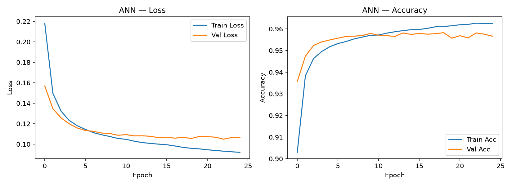
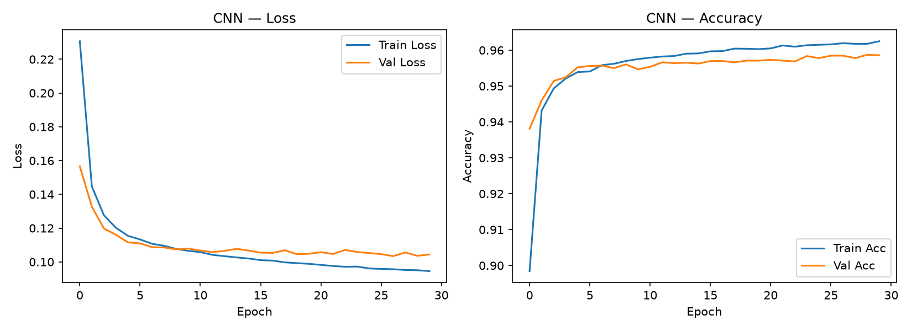
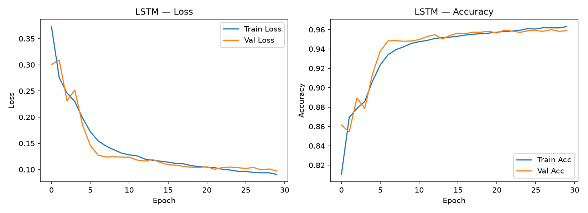
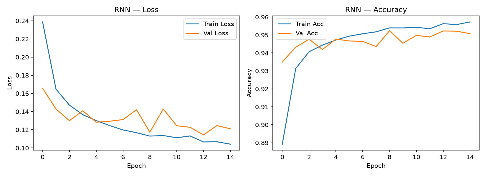
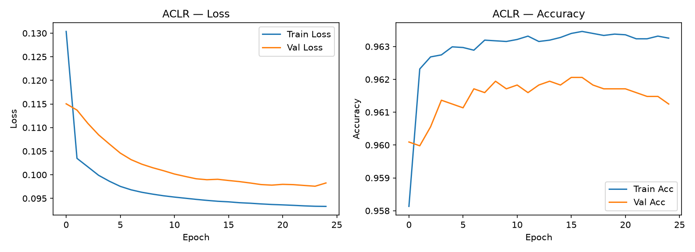
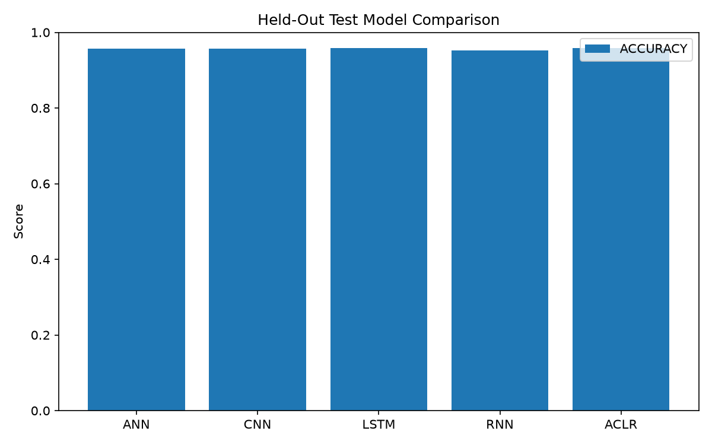
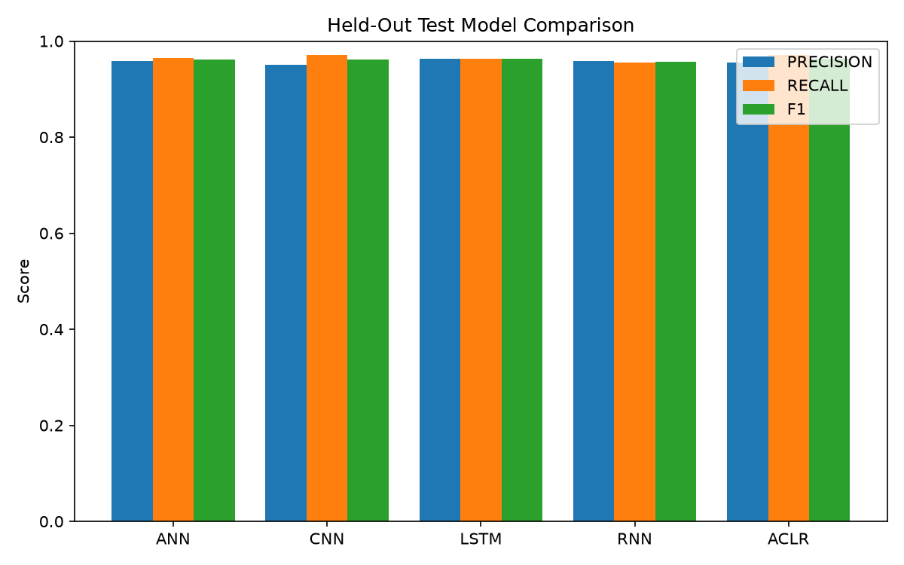
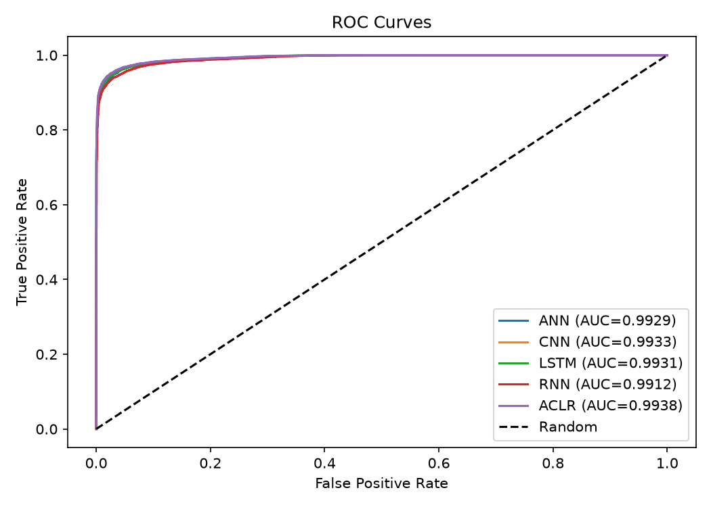
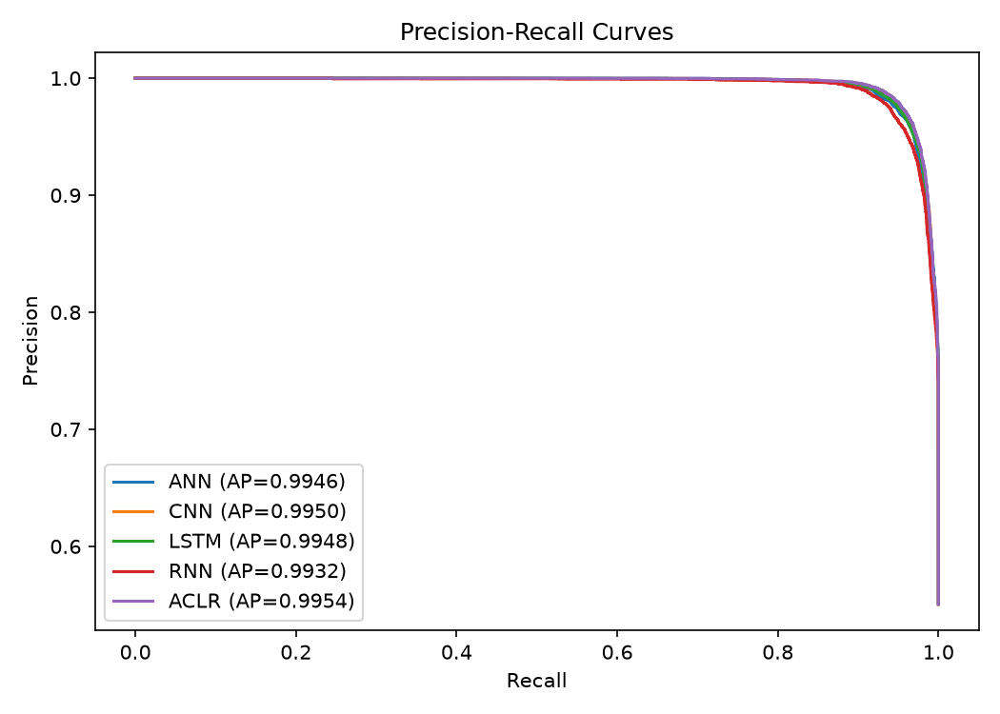

# NetSentinel Final Training Report

**Run:** `NetSentinel_20261103_113830`  
**Status:** Completed successfully (process exit code 0)  
**Run interval:** 2026-11-03 11:38:30–13:05:11 local time (1 h 26 min 41 sec)  
**Hardware:** Windows native TensorFlow CPU; no GPU detected  
**Random seed:** 42

## Dataset and partitions

The run used `dataset/UNSW_NB15_training-set.csv`: 82,332 rows, 37,000 normal and 45,332 attack labels, 42 model input features after dropping `id`, `attack_cat`, and target `label`; raw data contained no missing values.

The configured paper-style outer split is 70/30. To support validation-based checkpoint selection without looking at the held-out test set, the 57,632-row outer training portion was further split into 48,987 model-fit rows and 8,645 validation rows. The held-out test set contains 24,700 rows (11,100 normal and 13,600 attack). Index disjointness is asserted by the split builder.

Categorical features `proto`, `service`, and `state` use training-fitted LabelEncoders; a reserved code marks unseen categories. StandardScaler was fit on the 48,987 model-fit rows only (verified from the serialized preprocessor), then applied to validation and test. Feature order is retained from the training fit.

## Architectures and training configuration

All models used Adam at learning rate 0.001, binary crossentropy, batch size 32, and the configured model-specific epochs. Sequence models receive shape (42, 1).

| Model | Architecture | Configured / completed epochs |
|---|---|---:|
| ANN | Dense(64, ReLU) → Dense(32, ReLU) → Dense(1, Sigmoid) | 25 / 25 |
| CNN | Conv1D(64, k=3, same, ReLU) → MaxPool(2) → Conv1D(32, k=3, same, ReLU) → MaxPool(2) → Flatten → Dense(1, Sigmoid) | 30 / 30 |
| LSTM | LSTM(64) → Dense(32, ReLU) → Dense(1, Sigmoid) | 30 / 30 |
| RNN | SimpleRNN(64) → Dense(1, Sigmoid) | 15 / 15 |
| ACLR meta | Four base probabilities → Dense(64, ReLU) → Dense(32, ReLU) → Dense(1, Sigmoid) | 25 / 25 |

Base-model checkpoints monitored validation loss on the 8,645-row validation set; best checkpoints were reloaded before inference. ACLR OOF generation used StratifiedKFold with five folds on the 48,987 model-fit rows. Each row’s meta-training probability was generated by a base model trained without that row. The meta-model used the OOF matrix and training labels, with validation predictions used only for validation monitoring. The 24,700-row held-out test set was used for final evaluation only.

## Held-out test results

All rows below use the same saved `y_test.npy` (24,700 labels) and probabilities. Metrics were independently recomputed from the saved arrays and match the saved JSON values within rounding tolerance.

| Model | Accuracy | Precision | Recall | F1 | ROC-AUC | PR-AUC |
|---|---:|---:|---:|---:|---:|---:|
| ANN | 0.957611 | 0.958507 | 0.964779 | 0.961633 | 0.992915 | 0.994635 |
| CNN | 0.956680 | 0.950655 | 0.971765 | 0.961094 | 0.993307 | 0.994971 |
| LSTM | 0.958745 | 0.962571 | 0.962500 | 0.962535 | 0.993126 | 0.994832 |
| RNN | 0.952429 | 0.958115 | 0.955368 | 0.956739 | 0.991169 | 0.993231 |
| ACLR | **0.958785** | 0.955408 | **0.970441** | **0.962866** | **0.993818** | **0.995363** |

Confusion matrices use rows = true [Normal, Attack], columns = predicted [Normal, Attack]:

| Model | Confusion matrix |
|---|---|
| ANN | [[10532, 568], [479, 13121]] |
| CNN | [[10414, 686], [384, 13216]] |
| LSTM | [[10591, 509], [510, 13090]] |
| RNN | [[10532, 568], [607, 12993]] |
| ACLR | [[10484, 616], [402, 13198]] |

ACLR has the highest accuracy and F1 among these run results, but its accuracy is only 0.004 percentage points above LSTM. The distinction is very small; no statistical significance claim is made. The model ranking and exact values are reported as observed, without tuning to the paper.

## Visual results

### Training and validation curves

### Test comparison and curves

Test confusion-matrix plots for each of ANN, CNN, LSTM, RNN, and ACLR are in `outputs/plots/cm_*_test.png` inside the run directory.

## Reproducibility, checks, and limitations

- Configuration snapshot: [config.yaml](../runs/NetSentinel_20261103_113830/config.yaml).
- Full run metadata, including seed, device, partitions, and completed epoch counts: [run_metadata.json](../runs/NetSentinel_20261103_113830/reports/run_metadata.json).
- Model checkpoints and preprocessing object: [models/](../runs/NetSentinel_20261103_113830/models).
- Training histories: [histories/](../runs/NetSentinel_20261103_113830/histories).
- Machine-readable test metrics: [metrics_test.json](../runs/NetSentinel_20261103_113830/reports/metrics_test.json); predictions and labels: [outputs/](../runs/NetSentinel_20261103_113830/outputs).
- Logs: [train.log](../runs/NetSentinel_20261103_113830/logs/train.log) and [console.log](../runs/NetSentinel_20261103_113830/logs/console.log).
- Post-training test suite: **34 passed, 0 failed**; isolated end-to-end smoke run exited 0; synthetic two-fold CV smoke test passed.
- Every checkpoint was loaded successfully and its input/output shape matched the intended model; ACLR meta input/output shapes are (None, 4)/(None, 1). Saved prediction arrays are finite, have shape (24,700,), and reconcile to the metrics JSON.
- Runtime versions: Python 3.13.7, TensorFlow 2.21.0, NumPy 2.5.1, pandas 3.0.3, scikit-learn 1.9.1. The machine had no TensorFlow GPU.
- This experiment uses an additional validation split within the paper’s 70% outer training partition. This is a methodological difference from a direct 70/30 train/test run and may affect results. The base paper does not document the same internal validation protocol or the project’s random seed.
- The optional external five-fold evaluation was not run. The five folds reported here are the OOF folds for ACLR meta-training, not an external five-fold test estimate.
- The dataset is UNSW-NB15; it supports the stated binary normal/attack task here and does not establish generalization to later traffic distributions.

### Future improvements

- Run the optional external five-fold ACLR evaluation in a separate timestamped experiment if an independently scored CV estimate is needed; do not interpret the OOF training folds as an external CV score.
- Validate on a temporally or source-separated traffic collection to measure distribution shift and deployment generalization.
- Track unseen categorical values and feature drift during inference, and evaluate calibration and operating thresholds on validation data before deployment.

## Artifact inventory

All outputs from this run are contained in [runs/NetSentinel_20261103_113830/](../runs/NetSentinel_20261103_113830/). Existing root-level project checkpoints and reports were not overwritten.

